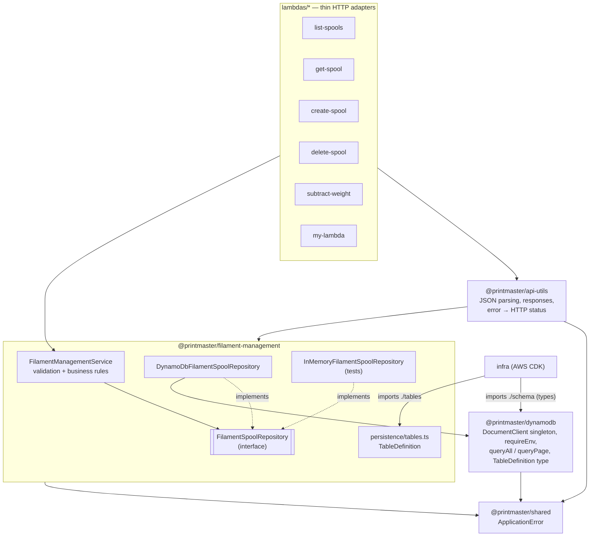
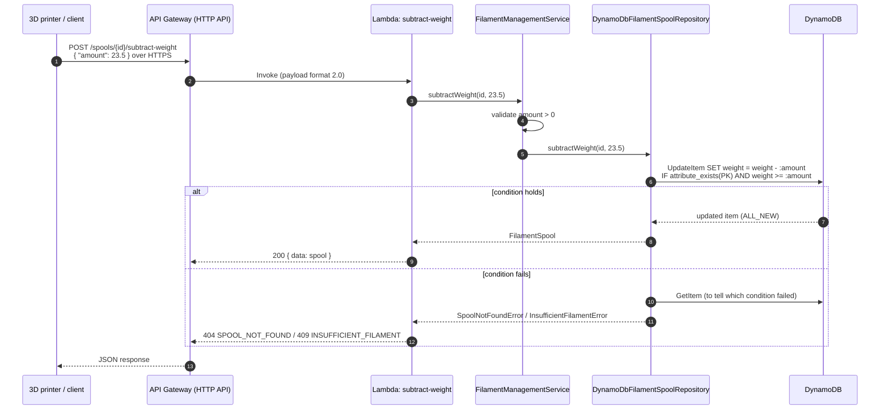
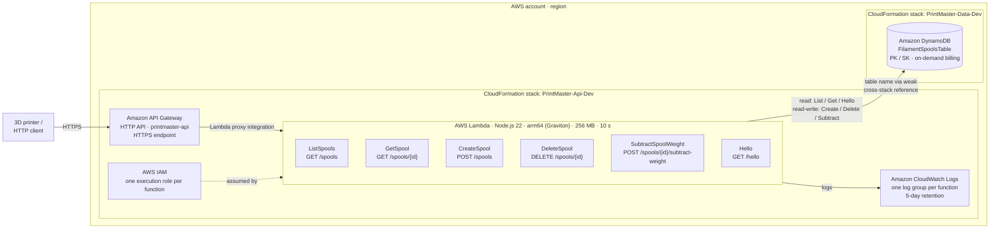
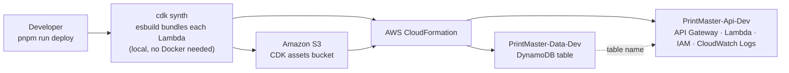

# PrintMaster

PrintMaster is a small serverless backend for managing **3D printer filament**. It keeps an
inventory of filament spools (name, colour, material, initial weight and remaining weight) and
tracks how much filament is left on each spool as prints consume it.

The app is **API-only**. There is no UI: a 3D printer, its host software or any HTTP client talks
to it over **HTTPS** through a JSON REST API. A typical setup registers spools once, then has the
printer (or a post-print script on its controller) report each job's filament usage. The API
subtracts that usage from the spool atomically and rejects requests that would take a spool below
zero.

- **Runtime:** TypeScript on Node.js 22 (ESM), running on AWS Lambda
- **Storage:** Amazon DynamoDB
- **Infrastructure as code:** AWS CDK (TypeScript)
- **Tooling:** pnpm workspace, esbuild, vitest, ESLint, Prettier

---

## Contents

- [API](#api)
- [Architecture](#architecture)
  - [Workspace layout](#workspace-layout)
  - [Package design](#package-design)
  - [Request flow](#request-flow)
  - [Data model](#data-model)
- [AWS infrastructure](#aws-infrastructure)
  - [AWS services](#aws-services)
  - [Stacks](#stacks)
- [Deployment guide](#deployment-guide)
- [Development](#development)

---

## API

All endpoints accept and return JSON. Successful responses wrap their payload in `data`. Errors
use one shape: `{ "error": { "code": "...", "message": "..." } }`.

| Method   | Path                          | Description                        | Success |
| -------- | ----------------------------- | ---------------------------------- | ------- |
| `GET`    | `/spools`                     | List all spools                    | `200`   |
| `GET`    | `/spools/{id}`                | Get one spool                      | `200`   |
| `POST`   | `/spools`                     | Register a new spool               | `201`   |
| `DELETE` | `/spools/{id}`                | Remove a spool                     | `204`   |
| `POST`   | `/spools/{id}/subtract-weight` | Record filament used by a print    | `200`   |
| `GET`    | `/hello`                      | Connectivity check (returns spools) | `200`   |

**Spool**

```json
{
  "id": "4f1c2a9e-8d3b-4c55-9a51-0d6c1e7b2f10",
  "name": "Galaxy Black",
  "color": "Black",
  "material": "PETG",
  "initialWeight": 1000,
  "weight": 640
}
```

`material` is one of `PLA`, `ABS` or `PETG`. Weights are in grams. `initialWeight` is fixed when
the spool is created. `weight` is the amount remaining.

**Create a spool:** `POST /spools`

```json
{ "name": "Galaxy Black", "color": "Black", "material": "PETG", "initialWeight": 1000 }
```

**Record usage:** `POST /spools/{id}/subtract-weight`

```json
{ "amount": 23.5 }
```

**Error codes**

| HTTP  | Code                    | When                                                        |
| ----- | ----------------------- | ----------------------------------------------------------- |
| `400` | `BAD_REQUEST`           | Missing or malformed JSON body, missing path parameter      |
| `400` | `INVALID_SPOOL_DATA`    | Validation failed (empty name, unknown material, weight ≤ 0) |
| `404` | `SPOOL_NOT_FOUND`       | No spool with that id                                       |
| `409` | `INSUFFICIENT_FILAMENT` | The spool has less filament left than the requested amount  |
| `500` | `INTERNAL_ERROR`        | Unexpected failure                                          |

---

## Architecture

### Workspace layout

Everything lives in `backend/`, a single **pnpm workspace** with three kinds of members:

```
backend/
├── packages/                 # Reusable libraries, shipped as raw TypeScript (no build step)
│   ├── shared/               # @printmaster/shared              – ApplicationError base class
│   ├── dynamodb/             # @printmaster/dynamodb            – DynamoDB client, pagination, table schema type
│   ├── filament-management/  # @printmaster/filament-management – domain logic + DynamoDB adapter
│   └── api-utils/            # @printmaster/api-utils           – HTTP helpers and error → status mapping
├── lambdas/                  # One deployable Lambda handler per API route
│   ├── list-spools/
│   ├── get-spool/
│   ├── create-spool/
│   ├── delete-spool/
│   ├── subtract-weight/
│   └── my-lambda/            # GET /hello
└── infra/                    # AWS CDK app: DataStack + ApiStack
```

### Package design

The code follows a **ports-and-adapters** (hexagonal) layout. Dependencies point inward: the
Lambdas know about HTTP, the domain package knows about spools, and storage sits behind an
interface.



What each layer is responsible for:

- **`@printmaster/shared`** holds `ApplicationError`. Every custom error in the codebase extends it
  and carries a stable `code` string, which is what ends up in API error responses.
- **`@printmaster/dynamodb`** is the generic DynamoDB toolkit. It provides a module-level
  `DynamoDBDocumentClient` singleton (reused across warm Lambda invocations), `requireEnv()` for
  table names, cursor pagination helpers, `isConditionalCheckFailed()`, and the framework-neutral
  `TableDefinition` type.
- **`@printmaster/filament-management`** is the domain. `FilamentManagementService` validates
  input and applies the business rules. It depends only on the `FilamentSpoolRepository`
  interface. The DynamoDB adapter implements that interface with **intent-level operations**
  (`create`, `subtractWeight`, `deleteById`) rather than a generic `save`. This lets each write
  run as a single atomic, conditional DynamoDB request. The package also **owns its table
  definition** (`./tables` subpath), so infra and runtime code share one source of truth for key
  names and the table-name environment variable.
- **`@printmaster/api-utils`** turns API Gateway events into domain calls and domain results into
  HTTP responses. `withErrorHandling()` maps each error class to an HTTP status code.
- **`lambdas/*`**: each Lambda is a few lines long. It builds the service once at module scope
  with `createFilamentManagementService()`, then parses the request, calls the service and returns
  JSON.
- **`infra`** turns the domain's `TableDefinition` into a real DynamoDB table and wires each
  Lambda to API Gateway with least-privilege access.

All library packages export **raw TypeScript** (`"exports": "./src/index.ts"`). Nothing is
prebuilt. At deploy time, esbuild bundles each Lambda together with the workspace packages it uses
into a single ESM file. The AWS SDK v3 is left external because the Lambda runtime provides it.

### Request flow

Here is what happens when a printer reports filament usage:



The check and the write happen in **one conditional `UpdateItem`**, so concurrent prints that
report usage against the same spool can't lose updates or drive the weight negative.

### Data model

Spools live in one DynamoDB table that follows **single-table design** with generic keys:

| Attribute    | Value                | Notes                                          |
| ------------ | -------------------- | ---------------------------------------------- |
| `PK`         | `SPOOLS`             | Partition key. All spools share one partition. |
| `SK`         | `SPOOL#<id>`         | Sort key, prefixed with the entity type        |
| `entityType` | `Spool`              | Identifies the item type                       |
| …            | spool fields         | `id`, `name`, `color`, `material`, `initialWeight`, `weight` |

| Access pattern       | DynamoDB operation                                    |
| -------------------- | ----------------------------------------------------- |
| List all spools      | `Query` on `PK = SPOOLS` (paginated, no `Scan`)       |
| Get spool by id      | `GetItem` on the full key                             |
| Create spool         | `PutItem` with `attribute_not_exists(PK)`             |
| Subtract weight      | `UpdateItem` with `weight >= :amount` condition       |
| Delete spool         | `DeleteItem` with `ReturnValues: ALL_OLD`             |

The mapping between domain objects and stored items (`toSpoolItem` / `fromSpoolItem`) lives in
`src/persistence/spool.item.ts`, so the domain types contain no storage attributes. For a full
walkthrough, see
[`backend/packages/filament-management/DYNAMODB.md`](backend/packages/filament-management/DYNAMODB.md).

---

## AWS infrastructure

The whole backend is **serverless and pay-per-use**: there are no servers, containers or VPCs to
manage, and an idle deployment costs close to nothing. The infrastructure is defined in TypeScript
with the **AWS CDK** (`backend/infra`) and deployed as two **AWS CloudFormation** stacks.



### AWS services

| Service                    | What it does in PrintMaster                                                                                                                                                                                                                                                          |
| -------------------------- | ------------------------------------------------------------------------------------------------------------------------------------------------------------------------------------------------------------------------------------------------------------------------------------ |
| **Amazon API Gateway**     | An **HTTP API** (API Gateway v2) named `printmaster-api` is the public entry point. It terminates **TLS** on its `https://<api-id>.execute-api.<region>.amazonaws.com` endpoint and routes each method and path to its Lambda through a proxy integration (payload format 2.0).                |
| **AWS Lambda**             | Six functions, one per route. Each runs **Node.js 22** on **arm64 (AWS Graviton)** with 256 MB of memory and a 10 s timeout. Code is bundled as ESM with source maps (`NODE_OPTIONS=--enable-source-maps`). The AWS SDK v3 comes from the Lambda runtime.                                         |
| **Amazon DynamoDB**        | One table, `FilamentSpoolsTable`, with a string `PK`/`SK` key and **on-demand (pay-per-request) billing**. CloudFormation generates the table name, and each Lambda receives it through the `FILAMENT_SPOOLS_TABLE_NAME` environment variable.                                               |
| **AWS IAM**                | Each function gets its own execution role. CDK grants **least-privilege** table access per route: read-only functions get `grantReadData`, and mutating functions get `grantReadWriteData`. The roles also include basic CloudWatch Logs write permissions.                                  |
| **Amazon CloudWatch Logs** | Each function has an explicitly created log group with **5-day retention**, so logs don't pile up indefinitely. The log groups are removed together with the stack.                                                                                                                          |
| **AWS CloudFormation**     | The two stacks, `PrintMaster-Data-Dev` and `PrintMaster-Api-Dev`, are CloudFormation stacks. The API stack reads the table name from the data stack through a **weak cross-stack reference** (`Fn::GetStackOutput`) rather than an `Export`/`ImportValue` pair, so the stacks stay loosely coupled. |
| **Amazon S3**              | The CDK bootstrap bucket (`cdk-*-assets-*`) stores the bundled Lambda code and the synthesized templates during deployment.                                                                                                                                                                  |
| **AWS Systems Manager**    | The CDK bootstrap stack (`CDKToolkit`) records its version in an SSM Parameter Store parameter, which `cdk deploy` checks.                                                                                                                                                                   |

All resources are tagged `project=printmaster` and `env=dev`.

### Stacks

The infrastructure is split by **lifecycle**:

- **`PrintMaster-Data-Dev`** (`lib/data-stack.ts`) holds stateful resources only: the DynamoDB
  table. It is built from the domain package's `TableDefinition` by `lib/tables.ts`, so the CDK
  table always matches the keys the runtime code expects. The table's construct id
  (`FilamentSpoolsTable`) is permanent and pinned by a test, because changing it would replace the
  table.
- **`PrintMaster-Api-Dev`** (`lib/api-stack.ts`) holds stateless resources: the HTTP API, the
  Lambda functions, their roles and their log groups. It receives the table through props and
  outputs `ApiUrl`. Because it holds no data, it can be destroyed and recreated at any time.



---

## Deployment guide

### 1. Prerequisites

- **Node.js 22**. The version is pinned in `backend/.nvmrc`, so run `nvm use` inside `backend/`.
- **pnpm**. Any recent global pnpm works: the workspace pins `pnpm@12.18.0`, and pnpm switches to
  that version automatically. Without a global pnpm, run `corepack enable`.
- **AWS CLI v2** with credentials for the target account.
- An IAM identity that is allowed to deploy CloudFormation stacks. CDK deploys through the roles
  that the bootstrap stack creates.

Docker is **not** required. Lambda bundling uses the esbuild binary installed in the workspace.

### 2. Install dependencies

```bash
cd backend
nvm use
pnpm install
```

### 3. Configure AWS credentials and region

CDK takes the account and region from your active AWS credentials (`CDK_DEFAULT_ACCOUNT` /
`CDK_DEFAULT_REGION`). Choose a profile and region:

```bash
# Option A: IAM Identity Center (SSO)
aws configure sso --profile printmaster
aws sso login --profile printmaster

# Option B: access keys
aws configure --profile printmaster

export AWS_PROFILE=printmaster
export AWS_REGION=eu-central-1   # any region you like

aws sts get-caller-identity       # confirm the account you are about to deploy to
```

### 4. Bootstrap CDK (once per account and region)

Bootstrapping creates the `CDKToolkit` stack: the S3 assets bucket, the deployment IAM roles and
the SSM version parameter.

```bash
cd infra
pnpm exec cdk bootstrap
```

### 5. Verify

Run the type check, the infra tests and a full synth before deploying:

```bash
pnpm verify
```

Optionally, review the change set against what is already deployed:

```bash
pnpm diff
```

### 6. Deploy

```bash
pnpm run deploy
```

> Use `pnpm run deploy`, **not** `pnpm deploy`. `deploy` is a built-in pnpm command, and the
> built-in takes precedence over the script.

This deploys both stacks (`cdk deploy --all`). CDK orders them automatically: the data stack
deploys first, then the API stack. CDK asks for confirmation before creating IAM resources.

When the deploy finishes, CDK prints the API URL:

```
Outputs:
PrintMaster-Api-Dev.ApiUrl = https://abc123xyz.execute-api.eu-central-1.amazonaws.com
```

You can read it again later with:

```bash
aws cloudformation describe-stacks --stack-name PrintMaster-Api-Dev \
  --query "Stacks[0].Outputs[?OutputKey=='ApiUrl'].OutputValue" --output text
```

### 7. Smoke test

```bash
API=https://abc123xyz.execute-api.eu-central-1.amazonaws.com

# Register a spool
curl -s -X POST "$API/spools" -H 'Content-Type: application/json' \
  -d '{"name":"Galaxy Black","color":"Black","material":"PETG","initialWeight":1000}'

# List spools
curl -s "$API/spools"

# Record 23.5 g used by a print
curl -s -X POST "$API/spools/<id>/subtract-weight" -H 'Content-Type: application/json' \
  -d '{"amount":23.5}'
```

### 8. Connect the printer

Point the printer's host software (or a post-print script or macro on its controller) at
`POST $API/spools/<id>/subtract-weight`. Send the filament weight used by the finished job, in
grams, as `amount`. Most slicers write the estimated filament weight into the G-code, so a
post-print hook can read that value and send it.

### Updating

After changing code, run `pnpm run deploy` again from `backend/infra`. CDK re-bundles only the
Lambdas whose code changed and updates the stacks in place. To deploy only one stack:

```bash
pnpm exec cdk deploy PrintMaster-Api-Dev
```

### Tearing down

```bash
pnpm run destroy
```

This removes both stacks, the log groups and the DynamoDB table. In the dev stage, the table is
created with `RemovalPolicy.DESTROY` and no deletion protection, so **all spool data is deleted**.
For a production stage, configure the data stack in `infra/bin/app.ts` with
`RemovalPolicy.RETAIN` and `deletionProtection: true`.

---

## Development

Commands run from the relevant package directory. There is no root-level script runner.

| Where                                 | Command                                       | What it does                                   |
| ------------------------------------- | --------------------------------------------- | ---------------------------------------------- |
| `packages/*`, `lambdas/*`             | `pnpm test`                                   | Run the vitest suite                           |
|                                       | `pnpm typecheck` / `pnpm lint` / `pnpm format` | TypeScript, ESLint, Prettier                   |
| `lambdas/*`                           | `pnpm build` / `pnpm package`                 | Bundle to `dist/index.mjs` / zip to `function.zip` |
| `infra`                               | `pnpm verify`                                 | Typecheck, infra tests (`node --test`), `cdk synth` |
|                                       | `pnpm synth` / `pnpm diff`                    | Synthesize templates / diff against AWS        |

Domain tests use `InMemoryFilamentSpoolRepository`. The DynamoDB adapter tests mock the AWS SDK
with `aws-sdk-client-mock`, so the test suites need neither AWS credentials nor a database. To run
the code against [DynamoDB Local](https://docs.aws.amazon.com/amazondynamodb/latest/developerguide/DynamoDBLocal.html),
set `DYNAMODB_ENDPOINT` (for example `http://localhost:8000`) together with
`FILAMENT_SPOOLS_TABLE_NAME`.

Conventions:

- ESM everywhere. Relative imports end in `.js`, and ESLint enforces this.
- Custom errors extend `ApplicationError` and carry a stable `code`.
- Prettier is configured with `printWidth: 100` and `trailingComma: all`.
