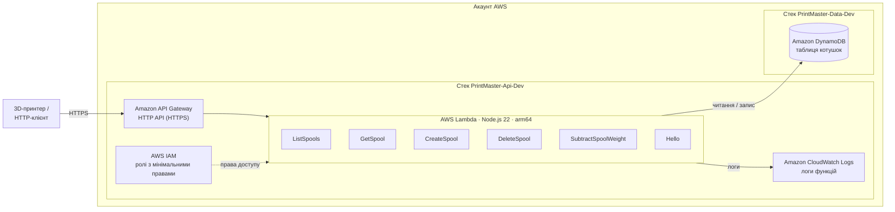
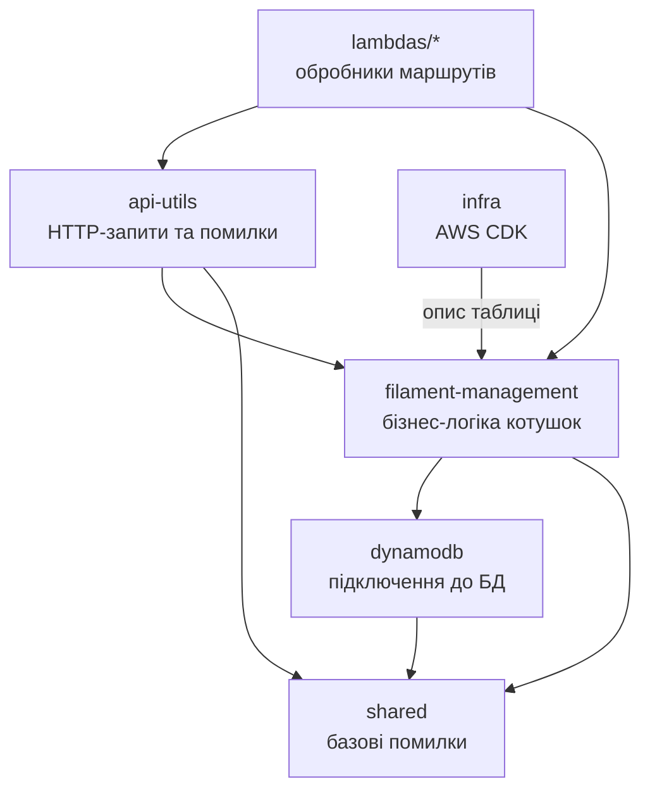

# PrintMaster

PrintMaster — це невеликий серверлес-бекенд для обліку **філаменту для 3D-принтера**. Він
зберігає перелік котушок (назва, колір, матеріал, початкова і залишкова вага) і відстежує, скільки
пластику залишилося на кожній котушці.

Застосунок працює **лише як API**, без інтерфейсу користувача. Принтер, його керуюче програмне
забезпечення або будь-який HTTP-клієнт звертається до нього через **HTTPS**. Котушки достатньо
зареєструвати один раз. Після кожного друку принтер надсилає, скільки філаменту витрачено, і
PrintMaster віднімає цю кількість від залишку на котушці.

**Технології:** TypeScript, Node.js 22, AWS Lambda, Amazon DynamoDB, AWS CDK, pnpm.

---

## Зміст

- [API](#api)
- [Архітектура](#архітектура)
  - [AWS-інфраструктура](#aws-інфраструктура)
  - [Структура коду](#структура-коду)
- [Розгортання](#розгортання)
- [Розробка](#розробка)

---

## API

| Метод    | Шлях                           | Опис                          |
| -------- | ------------------------------ | ----------------------------- |
| `GET`    | `/spools`                      | Список усіх котушок           |
| `GET`    | `/spools/{id}`                 | Одна котушка                  |
| `POST`   | `/spools`                      | Додати нову котушку           |
| `DELETE` | `/spools/{id}`                 | Видалити котушку              |
| `POST`   | `/spools/{id}/subtract-weight` | Списати витрачений філамент   |
| `GET`    | `/hello`                       | Перевірка з'єднання           |

Приклад котушки:

```json
{
  "id": "4f1c2a9e-8d3b-4c55-9a51-0d6c1e7b2f10",
  "name": "Galaxy Black",
  "color": "Black",
  "material": "PETG",
  "initialWeight": 1000,
  "weight": 640
}
```

Матеріал може бути `PLA`, `ABS` або `PETG`. Вага вказується в грамах. Якщо на котушці залишилося
менше філаменту, ніж потрібно списати, API відхиляє запит і не змінює залишок.

---

## Архітектура

### AWS-інфраструктура

Бекенд повністю **серверлесний**: немає серверів чи контейнерів, якими треба керувати, а оплата
залежить лише від кількості запитів. Інфраструктуру описано кодом за допомогою **AWS CDK**
(`backend/infra`) і розгорнуто як два стеки **AWS CloudFormation**.



#### Сервіси AWS

| Сервіс                     | Роль у PrintMaster                                                                                                                         |
| -------------------------- | ------------------------------------------------------------------------------------------------------------------------------------------ |
| **Amazon API Gateway**     | HTTP API — публічна точка входу. Приймає запити через HTTPS і передає кожен маршрут відповідній Lambda-функції.                             |
| **AWS Lambda**             | Шість функцій, по одній на кожен маршрут. Працюють на Node.js 22 і процесорах AWS Graviton (arm64), які дешевші за x86.                      |
| **Amazon DynamoDB**        | Одна таблиця для котушок з оплатою за запити (on-demand). Списання ваги виконується одним атомарним запитом, тож паралельні друки не конфліктують. |
| **AWS IAM**                | Кожна функція має власну роль. Функції, які лише читають дані, не мають права на запис.                                                     |
| **Amazon CloudWatch Logs** | Логи кожної функції. Вони зберігаються 5 днів, тому не накопичуються і не збільшують витрати.                                               |
| **AWS CloudFormation**     | Керує двома стеками: окремо для даних і окремо для API.                                                                                     |
| **Amazon S3**              | Під час розгортання CDK завантажує сюди зібраний код функцій.                                                                               |
| **AWS Systems Manager**    | Зберігає службовий параметр CDK (версію bootstrap-стека).                                                                                   |

#### Стеки

Інфраструктуру розділено на два стеки за життєвим циклом:

- **`PrintMaster-Data-Dev`** містить дані, тобто таблицю DynamoDB. Цей стек змінюється рідко.
- **`PrintMaster-Api-Dev`** містить API, Lambda-функції, ролі та логи. Він не зберігає даних, тож
  його можна будь-коли перестворити, не втративши жодної котушки.

### Структура коду

Увесь код розміщено в `backend/` — це один pnpm-воркспейс із трьома частинами:

- **`packages/`** — спільні бібліотеки:
  - `filament-management` — бізнес-логіка: робота з котушками та їх збереження в DynamoDB;
  - `dynamodb` — спільне підключення до DynamoDB;
  - `api-utils` — обробка HTTP-запитів і помилок;
  - `shared` — базовий клас помилок.
- **`lambdas/`** — окрема Lambda-функція для кожного маршруту API. Кожна з них лише приймає
  запит, викликає бізнес-логіку і повертає JSON.
- **`infra/`** — опис AWS-інфраструктури на CDK.



Бізнес-логіка не залежить від HTTP і від конкретної бази даних. Таблицю DynamoDB описано лише в
одному місці, у пакеті `filament-management`, і цей опис використовують як інфраструктура, так і
код. Під час розгортання кожна функція разом із потрібними їй пакетами збирається в один файл.

---

## Розгортання

### 1. Що потрібно

- **Node.js 22** (версію вказано в `backend/.nvmrc`)
- **pnpm** (потрібна версія підтягується автоматично)
- **AWS CLI** з доступом до акаунту AWS

Docker не потрібен.

### 2. Встановлення залежностей

```bash
cd backend
nvm use
pnpm install
```

### 3. Налаштування доступу до AWS

```bash
aws configure --profile printmaster      # або: aws configure sso --profile printmaster
export AWS_PROFILE=printmaster
export AWS_REGION=eu-central-1           # будь-який регіон

aws sts get-caller-identity              # перевірте, в який акаунт буде розгортання
```

### 4. Підготовка CDK (один раз для акаунту та регіону)

```bash
cd infra
pnpm exec cdk bootstrap
```

### 5. Перевірка та розгортання

```bash
pnpm verify          # перевірка типів, тести і збірка шаблонів
pnpm diff            # (необов'язково) що саме зміниться в AWS
pnpm run deploy      # розгортання обох стеків
```

> Використовуйте саме `pnpm run deploy`, а не `pnpm deploy`: `deploy` — це вбудована команда
> pnpm, і вона має пріоритет над скриптом.

Після розгортання CDK виведе адресу API:

```
PrintMaster-Api-Dev.ApiUrl = https://abc123xyz.execute-api.eu-central-1.amazonaws.com
```

### 6. Перевірка роботи

```bash
API=https://abc123xyz.execute-api.eu-central-1.amazonaws.com

curl -s -X POST "$API/spools" -H 'Content-Type: application/json' \
  -d '{"name":"Galaxy Black","color":"Black","material":"PETG","initialWeight":1000}'

curl -s "$API/spools"
```

### 7. Підключення принтера

Налаштуйте керуюче ПЗ принтера (або скрипт, що запускається після друку) так, щоб після кожного
завдання він надсилав запит:

```bash
curl -s -X POST "$API/spools/<id>/subtract-weight" -H 'Content-Type: application/json' \
  -d '{"amount":23.5}'
```

Тут `amount` — вага витраченого філаменту в грамах. Більшість слайсерів записує цю оцінку в
G-код.

### Оновлення та видалення

- Щоб оновити застосунок, знову виконайте `pnpm run deploy` у `backend/infra`.
- Щоб видалити всі ресурси, виконайте `pnpm run destroy`. У середовищі dev разом зі стеками
  видаляється і таблиця з усіма даними.

---

## Розробка

Команди запускаються з директорії відповідного пакета:

| Де                        | Команда                                        | Що робить                          |
| ------------------------- | ---------------------------------------------- | ---------------------------------- |
| `packages/*`, `lambdas/*` | `pnpm test`                                    | Тести (vitest)                     |
|                           | `pnpm typecheck` / `pnpm lint` / `pnpm format` | Типи, ESLint, Prettier             |
| `infra`                   | `pnpm verify`                                  | Типи, тести і збірка CDK-шаблонів  |

Для тестів не потрібні ні доступ до AWS, ні база даних.
